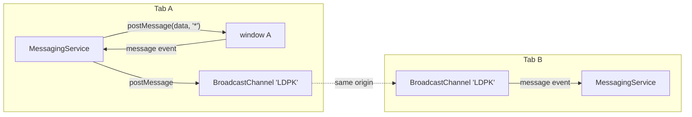

# Messaging

How `MessagingService` (`@lingo-daily/ng-bricks/messaging`) works. For usage, see the
[library README](../projects/ng-bricks/README.md#messagingservice).

## Goal

Send named messages, with an optional plain-object payload, to either:

- **the current tab** — `postToCurrentTab(message, payload?)`, or
- **all of the app's tabs, the current one included** — `postToAllTabs(message, channel?, payload?)`,

and let components subscribe to messages by name, including messages posted by third-party code
on the page. Subscribers don't learn which tab a message came from: "all tabs" means every tab
alike.

## Transports

Two browser APIs carry the messages:

| Transport                                                   | Reaches                                                                                                                       | Used for                                                        |
| ----------------------------------------------------------- | ----------------------------------------------------------------------------------------------------------------------------- | --------------------------------------------------------------- |
| `window.postMessage(data, '*')` on the service's own window | this tab's window only                                                                                                        | `postToCurrentTab`, and the current-tab half of `postToAllTabs` |
| `BroadcastChannel(name)`, `'LDPK'` by default               | every other channel object with that name on the same origin — other tabs, windows and workers, but not the object that posts | the other-tabs half of `postToAllTabs`                          |

`BroadcastChannel` never delivers to the channel object that posted, so `postToAllTabs` posts to
the window as well. That way the current tab gets exactly one copy, and every other tab gets one
through its own channel.

## Message format

Both transports carry the same data, copied with the structured clone algorithm:

- a **string** is a message without payload (also what `window.postMessage('name', '*')` from the
  console or a third-party script produces);
- `{ message: string, payload?: object }` is a message with payload;
- anything else is ignored by the default resolver.

`postToCurrentTab` posts a bare string when there's no payload; the channel always carries
`{ message, payload? }`.

A payload is a `MessagePayload` (`Record<string, unknown>`): a plain object whose prototype is
`Object.prototype` or `null` (`isMessagePayload`). Structured cloning turns class instances into
plain objects and keeps nested `Date`, `Map`, `Set` etc.; it throws `DataCloneError` for functions
and DOM nodes. A top-level payload that isn't a plain object after cloning (an array, `Date`, `Map`,
…) is dropped, and the message is delivered without it.

Third-party senders with other shapes (e.g. `{ type, data }`) are handled per subscription with a
`typeResolver: (data: unknown) => [message, payload?] | undefined`.

## Receiving

The service keeps:

- one `message` listener on `window`, attached while there is at least one subscription;
- one open `BroadcastChannel` per channel name that has subscriptions, closed when its last
  subscription ends.

Each event goes through `dispatch`, which for every subscription (iterating over a copy):

1. skips subscriptions removed earlier in the same dispatch (by another callback, or by destroying
   their owner);
2. for channel events, skips subscriptions on other channels;
3. for window events from another origin (`event.origin !== location.origin`), skips subscriptions
   without `acceptForeignOrigins: true` — cross-origin iframes, the window that opened the app and
   popups can all post to it;
4. runs the subscription's type resolver (a throwing resolver skips the event for that
   subscription only);
5. calls `callback(message, payload, event)` if the name matches; a throwing callback goes to
   Angular's `ErrorHandler` and doesn't stop delivery to the others.

Channel events need no origin check: `BroadcastChannel` only connects same-origin contexts.

## Lifecycle and fallbacks

- `subscribeToMessages` called in an injection context (e.g. a constructor) ends with the caller's
  `DestroyRef`; otherwise pass `destroyRef` or call `unsubscribe()`.
- `postToAllTabs` with no subscription on that channel posts through a short-lived
  `BroadcastChannel` and closes it right away, so posting alone keeps nothing open.
- When the service's injector is destroyed, it removes its listeners, closes its channels and
  ignores further calls.
- **SSR:** outside the browser (`isPlatformBrowser` is false) the service does nothing.
- **No `BroadcastChannel`, or it throws** (opaque origins such as sandboxed iframes throw
  `NotSupportedError`; blocked storage may throw `SecurityError`): messages reach the current tab
  only, with a dev-mode warning.

## Caveats

- **Several apps on one origin share a channel name.** Channel names are per origin, so two
  lingo-daily apps only share `'LDPK'` when they are served from the same origin. If two Angular
  roots run on the same page, each gets `postToAllTabs` messages from the other twice: once through
  the window and once through its own channel.
- **Messages aren't queued.** A tab that isn't loaded, or is frozen in the back/forward cache, misses
  the message (see below).

## Back/forward cache (bfcache)

`ApplicationUpdates` subscribes through the service, so every page that shows it keeps a
`BroadcastChannel('LDPK')` open with a listener. Question: does that stop browsers from restoring
the page instantly on back/forward?

### Test (2026-11-25)

Chrome 158 on macOS 26.6, a static page served from `127.0.0.1` (no dev server, whose live-reload
WebSocket blocks the cache by itself). Each run: load the page, follow a link to another page on the
same origin, go back, then read `pageshow`'s `event.persisted` and
`performance.getEntriesByType('navigation')[0].notRestoredReasons`.

| Page                                                              | Restored from bfcache                                                             | `notRestoredReasons`       |
| ----------------------------------------------------------------- | --------------------------------------------------------------------------------- | -------------------------- |
| No channel (control)                                              | yes (`persisted: true`)                                                           | —                          |
| Open `BroadcastChannel('LDPK')` with a `message` listener         | yes (`persisted: true`)                                                           | —                          |
| Same, and another page posts on `'LDPK'` while this one is cached | **no**: full reload (`back_forward`, `persisted: false`), and the message is lost | `broadcastchannel-message` |

### Findings

- In Chrome, an open channel doesn't prevent caching.
- Chrome **evicts** a cached page when its channel receives a message. Going back then reloads the
  page instead of restoring it. In practice this only happens when some tab calls `postToAllTabs` on
  that channel while the page sits in the cache, which is rare for `ApplicationUpdates` (its demo).
- Firefox and Safari weren't tested. Re-run the test above in both before relying on their
  behaviour.

### Possible mitigation (not implemented)

Close the service's channels on `pagehide` when `event.persisted` is true, and reopen them on
`pageshow`. The page would then stay restorable, at the cost of missing messages posted while it's
cached, which it misses anyway when it's evicted. Worth doing if an app starts posting to all tabs
regularly.
